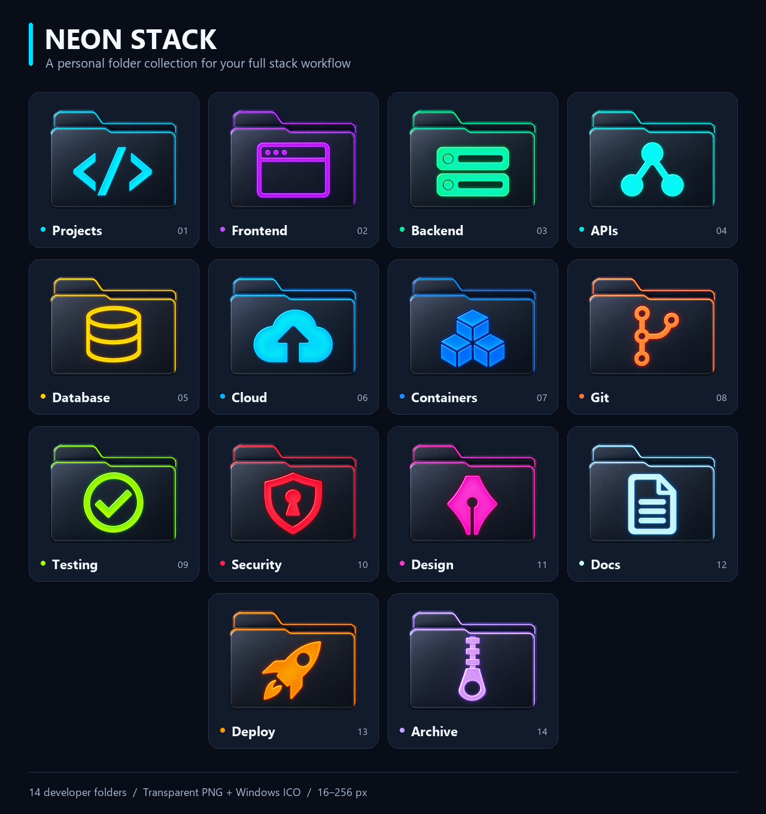

# Neon Stack

حزمة شخصية لشغل الـFull Stack: فولدرات جرافيت داكنة، حواف نيون، ورموز كبيرة وواضحة.



## المحتويات

- `Pack_NeonStack`: ملفات `00.ico` إلى `14.ico`. رقم `00` هو رمز القائمة، والأرقام `01–14` هي الأقسام.
- `PNG`: الصور الأصلية بخلفيات شفافة، بدقة 1254×1254.
- `Preview.png` و`Preview-Light.png`: معاينة المجموعة على خلفية داكنة وفاتحة.
- `Pixel-Preview.png`: الأحجام الفعلية 16 و24 و32 و48 بكسل.
- كل ملف ICO يحتوي مقاسات 16، 24، 32، 48، 64، 96، 128، 256 بكسل.
- `MENU-LABELS.txt`: أسماء الأيقونات حسب ترتيبها.
- `Install-NeonStack.ps1`: تركيب اختياري مع نسخة احتياطية للحزمة القديمة وملف الإعدادات.
- `PROMPTS.txt`: أوصاف التصميم المستخدمة مع أداة توليد الصور المدمجة.

| الملف | القسم | الاستخدام المقترح |
|---|---|---|
| 01.ico | Projects | المشاريع والمستودعات |
| 02.ico | Frontend | الواجهات وتطبيقات الويب |
| 03.ico | Backend | خدمات السيرفر |
| 04.ico | APIs | عقود وطلبات الـAPI |
| 05.ico | Database | قواعد البيانات والترحيلات |
| 06.ico | Cloud | موارد السحابة |
| 07.ico | Containers | Docker والحاويات |
| 08.ico | Git | المستودعات والفروع |
| 09.ico | Testing | الاختبارات ونتائجها |
| 10.ico | Security | إعدادات وأدوات الأمان |
| 11.ico | Design | التصميم وتجربة المستخدم |
| 12.ico | Docs | التوثيق والملاحظات |
| 13.ico | Deploy | النشر وإصدارات الإنتاج |
| 14.ico | Archive | المشاريع والإصدارات المؤرشفة |

## التركيب في FolderPainter

الإصدار 1.3 يتوقف عند 15 قائمة؛ إضافة مجلد جديد باسم Pack_23 لا تحل هذا الحد. اختَر مكان حزمة لا تحتاج ظهورها من Pack_01 إلى Pack_15.

1. فك ضغط الحزمة أولًا، ثم أغلق FolderPainter.
2. اختر رقم حزمة موجودة في واجهته ولا تستخدمها. المثال التالي يستخدم رقم 15؛ غيّره حسب اختيارك.
3. افتح PowerShell داخل مجلد Neon-Stack، واعرض خطة التغيير أولًا:

```powershell
.\Install-NeonStack.ps1 -FolderPainterPath 'C:\Tools\FolderPainter' -Slot 15 -WhatIf
```

4. لتطبيق التغيير على الحزمة التي اخترتها:

```powershell
.\Install-NeonStack.ps1 -FolderPainterPath 'C:\Tools\FolderPainter' -Slot 15
```

استبدل `C:\Tools\FolderPainter` بمسار برنامجك. لو تستخدم **CMD**، استدعِ PowerShell صراحةً واستخدم علامات اقتباس مزدوجة:

```cmd
powershell -NoProfile -File ".\Install-NeonStack.ps1" -FolderPainterPath "C:\Tools\FolderPainter" -Slot 15
```

التركيب ينسخ الأيقونات ويحدّث أسماء هذه القائمة فقط في أقسام اللغات، ويحفظ النسخة الأصلية داخل `NeonStack-Backups` بجوار البرنامج. يحافظ على إعدادات القوائم الأخرى، ولا يكتب في سجل ويندوز. إذا لم يسمح Windows بتشغيل السكربت، يمكنك استخدام الطريقة اليدوية أدناه.

5. افتح FolderPainter، واختر **Neon Stack**، ثم اضغط **Install** لتحديث القائمة المثبتة. قد تبقى أسماء القائمة القديمة حتى تعيد تثبيتها.

**انتبه لاختيار المكان:** أي فولدر قديم ما زال يشير إلى أيقونة داخل الحزمة المستبدلة سيعرض الأيقونة الجديدة. الفولدرات التي تحتوي نسخة مستقلة من أيقونتها لن تتأثر باستبدال ملفات الحزمة.

### طريقة يدوية

أغلق البرنامج، واحتفظ بنسخة من مجلد الحزمة التي اخترتها ومن `Icons\FolderPainter.ini`. انسخ ملفات `00.ico–14.ico` من `Pack_NeonStack` إلى مجلد تلك الحزمة. داخل ملف الإعدادات حدّث السطر الخاص برقمها في قسم اللغة الذي تستخدمه بالعنوان والترتيب الموجودين في `MENU-LABELS.txt`، ثم افتح البرنامج واضغط Install. استخدام رقم جديد أعلى من 15 لن يضيف قائمة إضافية.

### الرجوع للحزمة السابقة

أغلق البرنامج، وافتح مجلد النسخة الاحتياطية الذي طبع السكربت مساره. انسخ محتويات `Pack_XX` المحفوظة إلى الحزمة المقابلة داخل `Icons`، وأعد ملف `FolderPainter.ini` المحفوظ. افتح البرنامج ثم اضغط Install لتحديث القائمة. استعادة ملف الإعدادات ترجع أيضًا أي تعديلات أُجريت عليه بعد إنشاء النسخة الاحتياطية.

## استخدام الأيقونات مباشرة

تقدر تستخدم أي ملف ICO من خصائص الفولدر في ويندوز: **Properties → Customize → Change Icon**، من غير FolderPainter. احتفظ بالحزمة في مكان ثابت بعد ربطها بالفولدرات.

## ملاحظات

تم توليد الرسوم بأداة image_gen المدمجة، ثم تحويلها إلى ICO مع الحفاظ على الشفافية. تم التحقق من قراءة ويندوز لكل الأيقونات بمقاساتها الثمانية، وتجربة التركيب والنسخ الاحتياطي والاستعادة على نسخة اختبار منفصلة.

## ملفات تخصيص الفولدر وGit وVS Code

خيار **Copy icon while in folder** يحفظ نسخة من الأيقونة داخل الفولدر. ويستخدم ويندوز ملف `Desktop.ini` لتحديد أيقونة الفولدر. كون هذه الملفات مخفية في ويندوز لا يجعل Git يتجاهلها تلقائيًا.

لتجاهل ملفات الإعدادات، أضف السطر التالي إلى `.gitignore` في مشروعك:

```gitignore
[Dd]esktop.ini
```

أضف أيضًا **اسم ملف الأيقونة المنسوخة تحديدًا**. لا تستثنِ `*.ico` بالكامل، لأن مشروعك قد يحتاج `favicon.ico` أو أيقونات التطبيق. إذا كانت الملفات متتبعة بالفعل، فإضافتها إلى `.gitignore` لا تلغي تتبعها؛ افحصها قبل إزالة الملفات المعنية من فهرس Git مع الاحتفاظ بنسختها المحلية.

لإخفاء ملفات الإعدادات من مستكشف VS Code، ادمج الإعداد التالي في `.vscode/settings.json`، وأضف قاعدة مماثلة بالاسم الدقيق لملف الأيقونة المنسوخة:

```json
{
  "files.exclude": {
    "**/[Dd]esktop.ini": true
  }
}
```

إخفاء الملفات من مستكشف VS Code وتجاهلها في Git إعدادان منفصلان. احتفظ بملفات تخصيص الفولدر على القرص إذا كنت تريد استمرار استخدام أيقونته.

مراجع FolderPainter: [شرح التخصيص](https://www.sordum.org/10124/folder-painter-v1-3/) و[رد المطوّر بشأن حد القوائم](https://www.sordum.org/10124/folder-painter-v1-3/comment-page-11/).
